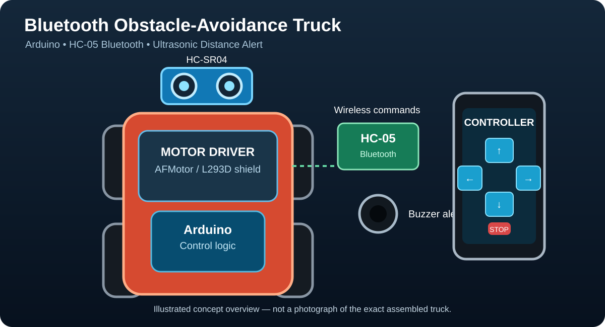
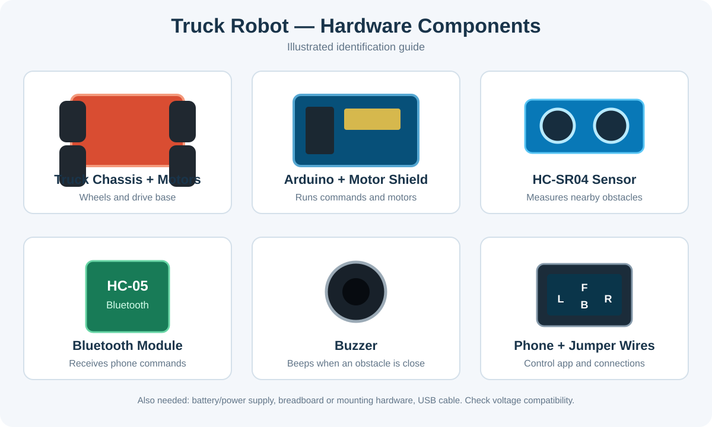

# Bluetooth Obstacle-Avoidance Truck Robot

An Arduino-based robot truck controlled wirelessly over Bluetooth. An HC-05 module receives movement commands, while an HC-SR04 ultrasonic sensor measures distance to nearby obstacles. The buzzer beeps in the warning zone and the truck stops when an obstacle is detected very close.

> The SVG graphics in this repository are illustrations for documentation, not photographs of the exact physical build.

## Hardware components

- Arduino Uno compatible board
- Motor driver shield compatible with the **AFMotor** library (commonly an Adafruit Motor Shield v1 / L293D-style shield)
- Two DC motors and a robot truck chassis with wheels
- HC-05 Bluetooth module
- HC-SR04 ultrasonic distance sensor
- Active/passive buzzer compatible with the sketch
- Jumper wires and mounting hardware
- Suitable motor battery/power supply and USB cable
- Android phone with a Bluetooth controller app that sends single-character commands

## Files

- `arduino/Truck_Project_Robotics.ino` — complete Arduino sketch.
- `images/truck-project-overview.svg` — project overview illustration.
- `images/hardware-components.svg` — component identification illustration.

## Pin connections

| Part | Module pin | Arduino pin |
|---|---|---|
| HC-05 | TXD | A5 (SoftwareSerial receive) |
| HC-05 | RXD | A4 (SoftwareSerial transmit) |
| HC-SR04 | TRIG | A1 |
| HC-SR04 | ECHO | A2 |
| Buzzer | Signal / + | A3 |
| Motor driver | Motor output 1 | Motor 1 connected to M1 |
| Motor driver | Motor output 2 | Motor 2 connected to M2 |

Connect sensor and module power/ground according to their specifications, and ensure the Arduino, Bluetooth module, sensor, and motor driver share a common ground. **Important:** Arduino Uno pins are 5 V logic. The HC-05 RXD input may require a voltage divider or level shifter; do not assume its RX pin is 5 V tolerant. Use a separate suitable motor supply and do not power DC motors directly from Arduino I/O pins. Check the motor shield and motor current requirements before powering the build.

## Bluetooth controller commands

The sketch expects one character per command at 9600 baud:

| Button/action | Character | Behavior |
|---|---|---|
| Up | `F` or `f` | Move forward |
| Down | `B` or `b` | Move backward |
| Left | `L` or `l` | Turn left (one motor backward, one forward) |
| Right | `R` or `r` | Turn right (one motor forward, one backward) |
| Stop | `S` or `s` | Release/stop both motors |

Configure the app to send these single-character commands. If the truck moves in the wrong direction, check motor wiring and shield output assignments.

## Obstacle alert behavior

- **More than 30 cm, or no echo:** no warning beep.
- **11–30 cm:** intermittent warning beeps; the interval becomes shorter as the obstacle gets closer.
- **10 cm or closer:** stop the truck and emit a short high-pitched alert.

The ultrasonic sensor has practical limits and may miss angled, soft, or narrow objects. Keep a hand near the power switch during testing.

## Software

- [Arduino IDE — official download](https://www.arduino.cc/en/software)
- [AFMotor library information](https://learn.adafruit.com/adafruit-motor-shield)
- [Arduino SoftwareSerial reference](https://docs.arduino.cc/learn/built-in-libraries/software-serial/)

Install a compatible AFMotor library for your motor shield before compiling. This sketch targets shields supported by the AFMotor library; newer motor shields may require a different library and code.

## How to run

1. Assemble the circuit and check all power and ground connections.
2. Install the AFMotor library compatible with your shield.
3. Open `arduino/Truck_Project_Robotics.ino` in Arduino IDE.
4. Select the correct board and COM port, then upload the sketch.
5. Pair the phone with the HC-05 and connect using a Bluetooth controller app.
6. Send `F`, `B`, `L`, `R`, and `S` to test movement in a clear area.
7. Test the ultrasonic warning with a soft obstacle while keeping the truck secured and easy to stop.

## Troubleshooting

- **Bluetooth commands do not work:** verify HC-05 pairing, baud rate (9600), and TX/RX wiring. The code uses `SoftwareSerial Bluetooth(A5, A4)`, meaning A5 is Arduino RX and A4 is Arduino TX.
- **Motor shield compile errors:** check that your shield is compatible with the AFMotor library.
- **Truck moves backward when pressing Up:** swap motor leads or adjust direction commands as appropriate.
- **Buzzer never warns:** verify TRIG/ECHO wiring and test distance readings.
- **Board resets when motors start:** use an appropriate motor supply and common ground; avoid drawing motor current from the Arduino 5 V pin.

This is an educational robotics project, not a certified collision-avoidance or safety system.
